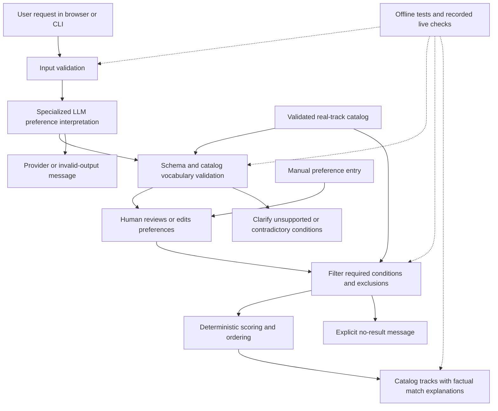

# Music Discovery Assistant — implementation plan

Planning date: November 14, 2026, America/New_York.
Status: combined Passes 2–3 app/evaluation implemented and verified offline. See pass23_report.md and SESSION_HANDOFF.md for current facts. Live model validation/comparison remains blocked; the starting-point section below is historical.

## 1. Requirements authority and decisions

Read `source/AI110_Final_Project_Codex_Prompt.md` in full, including both appendices, before implementation and after context compaction. It is a verbatim copy of Alex's supplied handoff. Its historical statement that no project has been selected is superseded by the decisions below. This plan and the requirements checklist organize the work; neither replaces or weakens the source requirements. Later explicit user instructions take precedence over older document instructions.

Confirmed by Alex in this chat:

- Extend Module 3 Music Recommender Simulation.
- Improve the recommender and its data, then integrate a natural-language AI assistant.
- A tiny fictional catalog is insufficient; support varied requests with meaningful musical attributes.
- Real independent tracks are acceptable; prioritize variety and reliable metadata.
- Use a local browser app for users and terminal commands for reproducible evidence.
- Use four focused passes, with a final audit of the finished app. Alex completed Pass 1, then requested Pass 2 and Pass 3 consecutively. Their independent app/evaluation work is implemented; live access remains pending, and Pass 4 is not yet performed.
- Alex now explicitly requests at least some bonuses. Target the evaluation harness (+2) and specialization behavior (+2), with observed evidence for each.
- Preserve all original assignment requirements and rubric rows across context compactions.

Scope: one integrated AI feature, structured prompting for natural-language preference interpretation, plus the necessary data, ranking, reliability, UI, tests, and documentation. Alex has now explicitly authorized a modest bonus scope: the evaluation harness and specialization behavior (up to +4). Keep other stretch categories out of scope unless separately requested. This is prompting-based specialization, not fine-tuning. Do not describe catalog filtering as RAG: the selected design does not generate answers from retrieved documents.

## 2. Verified starting point

- Course directory: `/Users/alexreifel/Coding Programs/CodePath AI 110`. The app-supplied `/Users/alexreifel/CodePath AI 110` path does not exist.
- Final directory: `ai110-applied-ai-system-project`; clean `main`, README-only initial commit `97724ce`.
- Final remote: `https://github.com/alexreifel/ai110-applied-ai-system-project`; public visibility and push permission verified using the GitHub connector during planning.
- Base directory: `ai110-module3show-musicrecommendersimulation-starter`; clean `main`, head `46eaeb6`.
- Base uses 20 synthetic songs, 17 genre labels, and 16 mood labels. Fifteen genre labels have one song each. Three example profiles demonstrate the application; they are not its complete category system.
- Ranking currently uses one genre, one mood, and energy. Tempo, valence, danceability, and acousticness exist in the CSV but do not affect scores.
- The base has CLI entry points, 52 tests described in its README, and CI for Python 3.11/3.12. Do not claim those tests passed this session: they have not been rerun.
- The inspected default Python 3.13 and course Python 3.9 environments lack pytest. Homebrew Python 3.11 is available; create a project-local environment during implementation.
- Streamlit skill discovery found no installed Streamlit in the parent course environment. Do not install into that shared Python 3.9 environment. Rerun discovery after installing dependencies in the project's Python 3.11 `.venv`.
- A `GOOGLE_API_KEY` environment variable name was observed earlier; its value, validity, quota, billing state, and usable model access are unverified. Never print or commit its value.
- Official course timing pages were inaccessible during inspection/planning. The supplied November 16, 2026, 2:59 a.m. New York deadline and November 18, 8 p.m. Demo Day time remain unverified prior observations.

## 3. User experience and responsibilities

1. The page explains catalog coverage and which attributes can be evaluated.
2. The user enters a request, such as a mix of folk and indie with an acoustic preference and a slower tempo.
3. The assistant interprets it into explicit preferences, exclusions, required conditions, and any unsupported or ambiguous conditions.
4. The app validates that interpretation and displays editable controls. Inferred numerical targets are visible design approximations, not facts about what the user meant.
5. The user reviews/edits the preferences and clicks Recommend. Changing them reranks locally without another model call.
6. The app displays up to five catalog tracks with artist, observed attributes, source reference, deterministic match explanations, and tradeoffs.
7. If a required condition cannot be evaluated or no tracks satisfy it, explain the gap and invite a revision. Do not silently substitute another category or relax exclusions to fill five results.

The CLI invokes the same interpretation, validation, and ranking services. It prints the interpreted preferences and has an explicit confirmation option for noninteractive, recorded demonstrations. A manual-preference path uses the same ranker without an API key. Fixture mode is explicitly labeled as offline/mock and cannot be presented as live AI evidence.

The assistant translates language; Python validates and ranks; the user controls the final preferences. Track facts and ranking explanations come from the catalog and score contributions, not model invention. Do not send the entire catalog to the model or ask it to invent tracks. Keep a single provider adapter and one model call per interpretation request. Do not make API requests on page rerenders or preference-control changes.

## 4. Data plan and acceptance gate

Recommended first candidate: [FMA](https://github.com/mdeff/fma). Its published metadata includes track identities and genre hierarchy; `echonest.csv` covers 13,129 tracks. The source documents CC BY 4.0 metadata. Download metadata only, retain attribution, and publish a small reproducible selection. Do not download or redistribute audio. These source-level counts are not counts of cleaned tracks in this project.

The [published usage notebook](https://github.com/mdeff/fma/blob/outputs/usage.ipynb) shows energy, tempo, valence, acousticness, danceability, and instrumentalness estimates. They are algorithmic attributes, not verified listener preferences. Mood interpretation may map to these attributes; do not fabricate a per-track mood label or equate high instrumentalness with a guarantee of no vocals.

Initial target: approximately 1,000 cleaned real tracks with at least 10 well-represented broad genres where source coverage permits. Aim for multiple artists and at least 20 tracks per supported broad genre rather than many one-song categories. These are engineering targets, not claims of achieved coverage or course requirements. Audit all available candidates before imposing a smaller subset; increase the snapshot if retaining it remains small and gives better useful coverage.

Before selecting the final snapshot:

- Verify actual download availability, archive checksum, release/source version, and reusable metadata terms; store source URL and attribution.
- Join identity, genre, and feature records by stable track ID; retain genre hierarchy and multiple labels.
- Reject duplicate IDs, blank titles/artists, malformed genres, invalid numeric ranges, and nonfinite values. Report exclusions and reasons.
- Do not fill unknown attributes with fabricated values or zero. Clearly separate optional missing fields from required usable ones.
- Report track and artist counts, genre distribution, numeric feature coverage/ranges, and duplicate/missingness statistics in `data/catalog_report.json`.
- Check representative mixed-genre, acoustic, low-energy, upbeat, and fast-tempo requests. Establish which preferences have enough matching tracks.
- Record selected-track IDs and a deterministic selection procedure and checksum. Commit the compact processed snapshot so users and CI can run without redownloading it.
- Verify references used in the demonstration; do not claim all historical source links still offer playable music.
- If FMA cannot support useful variety, document the actual gap and research one replacement; do not silently revert to synthetic production data.

An alternative considered was [MTG-Jamendo](https://github.com/MTG/mtg-jamendo-dataset), which provides genre, instrument, and mood/theme tags. Its metadata is CC BY-NC-SA 4.0 and its stated use is noncommercial research/academic use. FMA is the first candidate for continuity with the base's numerical features. No second data source is needed for the two selected bonus targets.

## 5. Data model and ranking

Proposed track record: stable ID; title; artist/artist ID; genre labels; genre ancestors; source reference; available energy, tempo, valence, acousticness, danceability, and instrumentalness estimates. Keep provenance for imported values and any explicit deterministic transformations.

Proposed preference record:

- Zero or more preferred genres, interpreted as alternatives, plus explicit excluded genres.
- Optional desired levels/ranges for supported numeric features; leave unrequested dimensions unset.
- A clear distinction between hard conditions (must not be violated) and soft preferences (used to rank).
- Unsupported conditions and a focused clarification when needed.
- A short visible interpretation summary. No hidden reasoning/chain-of-thought request or retention.

Reject unknown JSON keys, wrong types, booleans masquerading as numbers, nonfinite/out-of-range values, reversed ranges, oversized lists, invalid labels, empty interpretations, and contradictory include/exclude conditions. Use the catalog's supported vocabulary in the prompt. Do not force an unsupported subgenre into an unrelated category; expose any broader-genre interpretation for review.

Ranking first filters hard constraints, including exclusions and feature bounds, then scores soft preferences using a documented weighted similarity calculation over requested dimensions only. Use explicit genre ancestry matching and numeric distances; show the actual contributing attributes. Normalize only to make scores comparable within the documented formula; a match score is not calibrated confidence or the probability of enjoyment.

Handle an empty eligible set explicitly. If all surviving tracks are poor soft matches, label them as compromises or return no suitable matches according to a documented, tested rule. Choose that rule using recorded examples; do not invent a quality/accuracy claim. Keep tie ordering deterministic and cap repeated artists in the short recommendation list if the audit shows repetitive results; document any such behavior rather than adding a separate diversity system.

Preserve the original synthetic CSV, CLI demonstration, scoring implementation, and tests as a reproducible baseline. New richer behavior should be a clear extension sharing useful existing logic where appropriate, not a rewrite that makes the original comparison impossible.

## 6. Components and proposed file layout

```text
app.py                             browser UI; explicit Interpret and Recommend actions
src/main.py                        preserved base demonstration
src/recommender.py                 preserved base ranking and compatibility interfaces
src/catalog.py                     validated real-track catalog and supported vocabulary
src/preferences.py                 typed preference schema and deterministic checks
src/llm_client.py                   one provider, configured model, bounded timeout
src/assistant.py                    request -> interpretation -> validation service
src/ranking.py                      richer constraint filtering and scoring
src/cli.py                          terminal entry point sharing the same backend
prompts/preference_parser.txt       actual specialization instructions and examples
data/songs.csv                     original 20-song synthetic baseline
data/catalog.csv                   versioned real-track snapshot (format may be JSONL)
data/catalog_report.json            observed coverage and cleaning results
data/README.md                     provenance, attribution, feature meanings, build recipe
tests/                             inherited regression tests plus substantive new tests
evaluation/                        captured commands/results; live and mock labels
assets/README.md                    purpose of required asset directory
diagrams/architecture.mmd           final diagram matching implemented components
model_card.md                       all graded reflection and ethics prompts
docs/presentation_outline.md        5–7 minute presentation preparation
docs/portfolio_draft.md             factual summary and personal text for Alex review
docs/requirements_checklist.md      all 21 exact rubric rows plus operational requirements
docs/implementation_plan.md         this document
docs/SESSION_HANDOFF.md              durable current decisions/status and resume instructions
docs/source/AI110_Final_Project_Codex_Prompt.md  verbatim supplied source
```

Layout is proposed and can be simplified during implementation. Use a small Python service layer and plain files. No vector database, agent framework, application server deployment, accounts, streaming integration, or online catalog ingestion is necessary. Interactive recommendations operate over a fixed catalog snapshot. Read current Streamlit skill documentation from the new environment before implementation; use explicit state so rerenders do not repeat provider calls or show results from an obsolete interpretation.

Proposed flow (design only; replace/update `diagrams/architecture.mmd` to reflect actual code):



## 7. Provider, reliability, and privacy

Start by checking usable Gemini access because the course references it, without exposing secrets or changing billing. Select and document the actual model identifier only after verifying availability and cost constraints. [Gemini structured-output documentation](https://ai.google.dev/gemini-api/docs/structured-output) supports schema-based extraction; schema conformity still does not prove semantic correctness. Use local validation and human review.

- Blank, overly long, nonmusic, ambiguous, and contradictory requests get meaningful messages.
- Unsupported essential conditions (such as explicit-lyrics guarantees without a verified field) prevent claiming a successful match; the user can explicitly revise them.
- Malformed JSON/schema errors do not reach the ranker. The model cannot choose arbitrary files, execute code, access arbitrary URLs, or expand its allowed fields.
- Separate missing configuration, authentication/model access, quota/rate limiting, timeout, provider error, invalid output, and legitimate no-results.
- Bound input/output size and network timeout. Default to no automatic retry; add at most one justified transient retry within a fixed overall budget if needed. Do not retry authorization or validation failures blindly.
- Live calls require confirmed usable access consistent with Alex's no-unapproved-charges constraint. Never enable billing. No live calls are needed during planning.
- Log event type, mode/model, validation outcome, catalog IDs, and timing as useful. Redact credentials and provider error bodies. Avoid persisting personal request text by default; use nonpersonal chosen examples for committed evidence.
- Manual mode remains usable when the provider is unavailable. Clearly labeled fixture clients support offline tests; neither substitutes for live verification.
- A syntactically valid interpretation can still misunderstand language; show that risk in the UI and model card. Deterministic checks cannot prove every natural-language condition was understood.

## 8. Implementation order and completion checks

Follow the four-pass sequence in [execution_passes.md](execution_passes.md). That file records implementation order, concrete deliverables, exit checks, the selected +4 bonus target, and the final source/rubric audit. It groups the earlier planning phases into four coherent passes while preserving every source requirement. Each build pass includes relevant tests and evidence; validation is not deferred to the final pass.

The latest user message authorizes pursuing bonuses. This supersedes the original handoff's restriction on unsolicited bonus work for the two selected categories only. Do not add RAG or an agent to chase unrelated bonus rows.

## 9. Definition of done

Each of the 21 required rubric rows has concrete implementation/documentation and observed evidence, with no invented grade or execution. Audit both criteria in each selected bonus category too; target up to 25 available points, without claiming an official score or guaranteed credit. Every additional source instruction is checked. Successful live examples and a working browser workflow demonstrate the new feature when access permits; otherwise report the specific live gap and never mark full live verification complete. Personal review and presentation delivery are tracked honestly. Catalog variety and ranking quality are supported by an audit and structured examples rather than song count alone.
